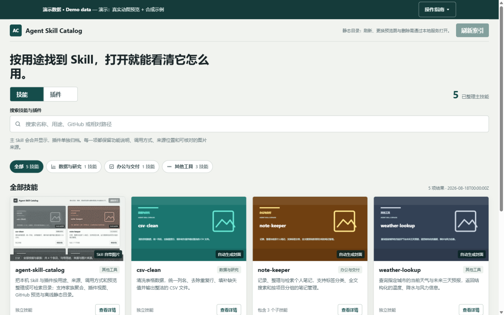
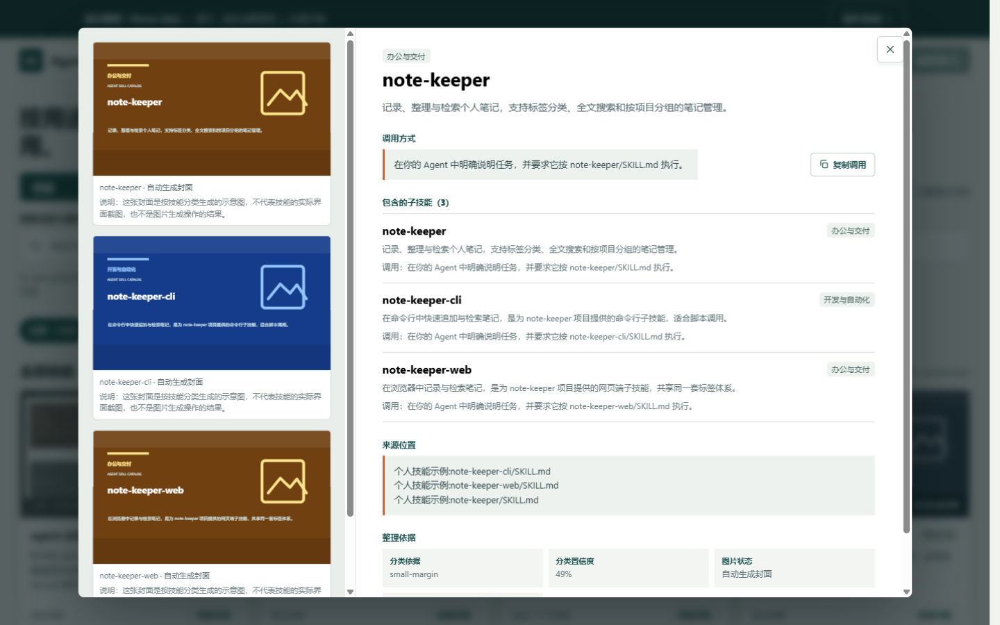

# Agent Skill Catalog

Turn the Agent Skills already on your machine into one searchable local catalog — with each Skill's own cover image, its source, and its invocation.

Point it at the folders where your `SKILL.md` files live and it builds a self-contained HTML catalog. Cover discovery starts with what each Skill already ships: a frontmatter or sidecar image, or a picture linked from its own README, with original GIF/WebP animation kept intact. GitHub is read only for entries that still have no local image. Skills installed from one repository are grouped into one family even when their names share no prefix, plugins keep their own view, and the detail dialog shows the invocation plus any sourced public introduction with its retrieval date.

<p align="center">
  <a href="https://mianbaofang.github.io/agent-skill-catalog/demo/"><strong>Open the live demo</strong></a>
  &middot;
  <a href="#install"><strong>Install v0.5.1</strong></a>
  &middot;
  <a href="README.zh-CN.md">中文</a>
</p>

<p align="center">
  <a href="https://mianbaofang.github.io/agent-skill-catalog/demo/">
    
  </a>
</p>

<p align="center">
  <em>Intro film shot from a real local catalog build on the author's machine. Captions are in Chinese, matching the generated UI.</em>
</p>

<p align="center">
  <a href="https://mianbaofang.github.io/agent-skill-catalog/demo/">
    
  </a>
</p>

<p align="center">
  <em>Screenshots come from the committed offline demo and are reproducible without a network. Cards with a real local cover are marked as such; entries without one keep the explicitly labelled generated fallback.</em>
</p>

## Install

One line with the `skills` CLI (works for Claude Code, Codex, Cursor, Gemini CLI and more; also lists the skill on [skills.sh](https://www.skills.sh/mianbaofang/agent-skill-catalog)):

```bash
npx skills add mianbaofang/agent-skill-catalog
```

Install the published release with GitHub CLI (the path validated on Windows):

```powershell
gh skill install mianbaofang/agent-skill-catalog agent-skill-catalog --pin v0.5.1 --agent codex --scope user
```

To track the latest source on `main` instead of a tagged release, pin the branch:

```powershell
gh skill install mianbaofang/agent-skill-catalog agent-skill-catalog --pin main --agent codex --scope user
```

`--pin main` installs whatever is currently on the repository's `main` branch, which moves between
releases; prefer the `v0.5.1` command above for a stable build.

Then tell your agent which roots to scan:

```text
Use agent-skill-catalog to scan my local Skill root and Codex plugin cache.
Keep standalone Skills and plugins separate, group real parent/child families,
and do not install, edit, or execute anything that was scanned.
```

## Build your first catalog from source

`gh skill install` puts the scripts inside the installed Skill package, not in a working copy of this
repository. To run the builder as shown below, clone or download this repository first and run from
its root, so the relative path to `build_catalog.py` resolves:

```bash
git clone https://github.com/mianbaofang/agent-skill-catalog.git
cd agent-skill-catalog
```

Replace the two paths with a real Skill folder and an empty output folder. This first command stays
fully offline and does **not** wait for missing Chinese descriptions:

Bash:

```bash
python skills/agent-skill-catalog/scripts/build_catalog.py \
  --root "/path/to/skills" \
  --output-dir "/path/to/catalog-output" \
  --no-github-discovery \
  --no-github-images
```

PowerShell:

```powershell
python skills/agent-skill-catalog/scripts/build_catalog.py `
  --root "C:\path\to\skills" `
  --output-dir "$env:TEMP\agent-skill-catalog-preview" `
  --no-github-discovery `
  --no-github-images
```

Exit code 0 writes `catalog.json` and a self-contained `index.html`. Open `index.html` in a browser
and search. If the output folder already contains a `catalog.json`, the builder stops and asks you to
rerun with `--refresh`; check that the target holds a catalog you are willing to regenerate first.

### Two completion states

| Build | Command | Success looks like |
|---|---|---|
| Quick preview | `build_catalog.py ... --no-github-discovery --no-github-images` | Exit code 0. Entries with missing Chinese descriptions still appear; browse and search right away. |
| Enriched catalog | add `--require-complete-descriptions` | Exit code 0 **and** `pending_description_count` equal to zero. Exit code 3 means Chinese descriptions are still pending, not that the program crashed. |

The enriched path is what an agent drives: it fills pending Chinese descriptions from bounded local
`SKILL.md` and GitHub README evidence through a resumable `description_queue.py next/apply` loop,
then rebuilds with `--refresh --require-complete-descriptions` until the queue is empty. The Python
scripts do not call a hidden model and do not need a provider key. See
[Build an offline skill catalog](https://mianbaofang.github.io/agent-skill-catalog/guides/offline-skill-catalog.html)
for the full loop, and `references/workflow.md` in the Skill package for agent-facing steps.

## Scan status and refresh changes

> The scan report and grouping fix are unreleased source changes; the published v0.5.1 installer does not contain them yet.

Expand the scan report to see the index time, unresolved roots, skipped linked directories, and GitHub fetch settings. Added / no-longer-indexed items are compared only across identical scan scopes; a root or configuration change starts a new baseline. No longer indexed does not mean deleted. Family-card counts and raw Skill-entry counts are labelled separately.

<details>
<summary>See the generated catalog and detail view</summary>

## What the catalog actually shows

The screenshots come from a real generated catalog; the interface is Chinese. Each one is a captured
offline snapshot built from committed demo fixtures (one real public reference and synthetic examples), reproducible without a network.

<table align="center"><tr><td></td></tr></table>

<table align="center"><tr><td></td></tr></table>

</details>

## Why I built this

After a year of installing Agent Skills I had hundreds of them scattered across tool directories, and many lived behind junctioned folders on another drive. Whenever I wanted "the skill that does X", the only way to find it was to open `SKILL.md` files one by one — no covers, no search, and no visible invocation to copy. This catalog came out of that exact scene: point it at the roots I already have and get one local page where every skill shows its own cover, its source, and a copyable invocation — while never installing, editing, or executing anything that was scanned.

## Task guides

Each guide covers one concrete job, with cross-platform commands, expected output, limits, and
troubleshooting:

- [Search the agent skills you already installed](https://mianbaofang.github.io/agent-skill-catalog/guides/search-installed-skills.html) —
  pick an explicit root, build, search, and open a Skill's invocation and source.
- [Build an offline skill catalog](https://mianbaofang.github.io/agent-skill-catalog/guides/offline-skill-catalog.html) —
  turn every GitHub request off, and understand the quick-preview and enriched completion states.
- [Inventory skills and plugins across folders](https://mianbaofang.github.io/agent-skill-catalog/guides/skills-and-plugin-inventory.html) —
  scan several roots, group plugins, and read verified duplicates versus same-name collisions and families.

These guides describe the current Chinese catalog UI.

## At a glance

| Question | Answer |
|---|---|
| What does it scan? | Only the local roots you pass explicitly, including optional roots labeled as plugin caches. |
| What is one entry? | A standalone Skill, or one parent/family record whose child Skills are listed in the detail view. |
| What about duplicate installs? | Copies backed by the same observed GitHub repository and Skill name collapse to one entry, while every source location stays available as evidence. |
| How are plugins shown? | Plugin aggregates get their own view and are not counted as standalone Skills. |
| Where do animated previews come from? | From a Skill's own public GitHub README when the builder is allowed to read GitHub. The catalog keeps the raw GIF/WebP frames; it does not generate new animations. |
| What if evidence is missing? | The catalog says `missing evidence`; a generated category cover is never presented as a Skill-specific image. |
| What stays off limits? | Scanning does not write to your roots. See [Safety](#safety-and-responsible-use) for the one optional, disabled-by-default server capability and the optional network reads. |

## Operating modes

| Mode | Use it when | Output |
|---|---|---|
| Static build | You only need a shareable local file | Deterministic `catalog.json` and self-contained `index.html`. |
| Local server | You want refresh and manual preview-image controls | The static catalog plus localhost-only `/api/refresh` and `/api/image` endpoints. |
| Reviewed curation | Automatic evidence is ambiguous | Scoped category, family, description, GitHub, or image overrides in a separate JSON file. |
| Plugin inventory | You scan a plugin cache | A separate plugin view with the Skills carried by each plugin. |

To use the in-page refresh action, start the local server with the same roots. Add the two offline
flags so the refresh path stays offline too:

```powershell
python skills/agent-skill-catalog/scripts/serve_catalog.py `
  --output-dir "$env:TEMP\agent-skill-catalog-preview" `
  --root "C:\path\to\skills" `
  --no-github-discovery `
  --no-github-images
```

## Network use, and how to turn it off

A default build is **not** guaranteed offline. Here is exactly what can touch the network and the
switch that disables each one:

| What happens | When | Switch that disables it |
|---|---|---|
| Skill names from your library are sent to the GitHub repository search API as `"<name>" in:name` queries, to find candidate repositories for entries that have no repository metadata yet. | Default build | `--no-github-discovery` |
| For observed repositories, public preview images — including animated GIF/WebP frames — are fetched from allowlisted GitHub hosts and cached in the output directory. | Default build | `--no-github-images` |
| Public GitHub README excerpts are fetched as evidence for the Chinese description queue. | `description_queue.py next` | `--no-github-readmes` |

GitHub reads are HTTPS-only, host-allowlisted, and size-limited. If a `GH_TOKEN` or `GITHUB_TOKEN`
environment variable is set, or you are already signed in with the GitHub CLI, that existing
credential is reused for these reads; the catalog never stores it. A build with
`--no-github-discovery --no-github-images` (and `description_queue.py next --no-github-readmes` when
you run the queue) makes no GitHub request at all.

## Safety and responsible use

- Scan roots are explicit and read-only; the builder does not traverse unrelated folders.
- The local server has an optional delete capability, disabled unless you set `allow_delete` to `true` for a root. When enabled, it can permanently remove a top-level standalone Skill directory from the scanned source after you confirm the full Skill name. Family and plugin entries are excluded, and it does not delete root configuration. Keep it off if you want a strictly read-only browsing setup.
- Skill-provided remote image URLs remain metadata only. For an observed GitHub repository, the builder may read the public repository page and allowlisted GitHub image hosts to cache one size-limited, signature-checked preview.
- Manual preview images are written only to `curated-images/` and `catalog-curation.json` inside the selected output directory.
- Absolute paths are redacted by default. `--include-absolute-paths` is an intentional local diagnostic option.
- Refresh accepts only the roots, labels, kinds, config, and curation files that were recorded at startup.
- Category, family, image, and GitHub claims remain evidence-backed; uncertain records stay marked for review.

See the full [Disclaimer](DISCLAIMER.md) and [Security](SECURITY.md) notes before using the catalog
with private or third-party Skill repositories.

## Repository layout

```text
skills/agent-skill-catalog/SKILL.md GitHub-discoverable Skill entry
skills/agent-skill-catalog/       versioned installable Skill package
skills/agent-skill-catalog/references config, schemas, curation, and workflow
skills/agent-skill-catalog/scripts  scanner, HTML renderer, and bounded server
docs/                              project site, guides, and generated demo
docs/media/                        README screenshots and product animation
tests/                             deterministic behavior checks
tools/                             package and release validation
.github/                           CI, issue, and pull-request templates
CHANGELOG.md                       release history
```

## Status

- Current published release: [`v0.5.0`](https://github.com/mianbaofang/agent-skill-catalog/releases/tag/v0.5.0)
- Installable package: [`agent-skill-catalog-skill.zip`](https://github.com/mianbaofang/agent-skill-catalog/releases/latest/download/agent-skill-catalog-skill.zip)
- Package checksum: [`agent-skill-catalog-skill.zip.sha256`](https://github.com/mianbaofang/agent-skill-catalog/releases/latest/download/agent-skill-catalog-skill.zip.sha256)
- Validation: GitHub Skill discovery, package structure, Python compilation, deterministic catalog tests, and release packaging run in CI and before release.

See the [Changelog](CHANGELOG.md) for version history.

## Acknowledgements

The project follows the public [Agent Skills specification](https://agentskills.io/specification) and
uses Python's standard library for scanning, deterministic JSON generation, and the local HTTP server.
The demo animation combines original explanatory information graphics with a real catalog UI
recording. The public demo and screenshots use synthetic fixtures created for this project and placed
under `examples/`; they are not part of the installable Skill package. The animated preview shown in
the demo card is a locally derived fragment of this project's own public promo animation, not a
third-party asset. Your own installed
Skills, private prompts, and private assets are never bundled.

See [Acknowledgements](ACKNOWLEDGEMENTS.md) for the attribution and non-affiliation boundary.

## Author

Ethan <ethan.zl@hotmail.com>

## License

[MIT](LICENSE).