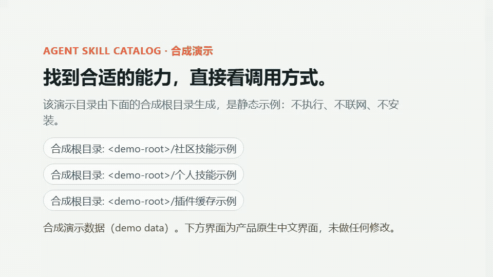
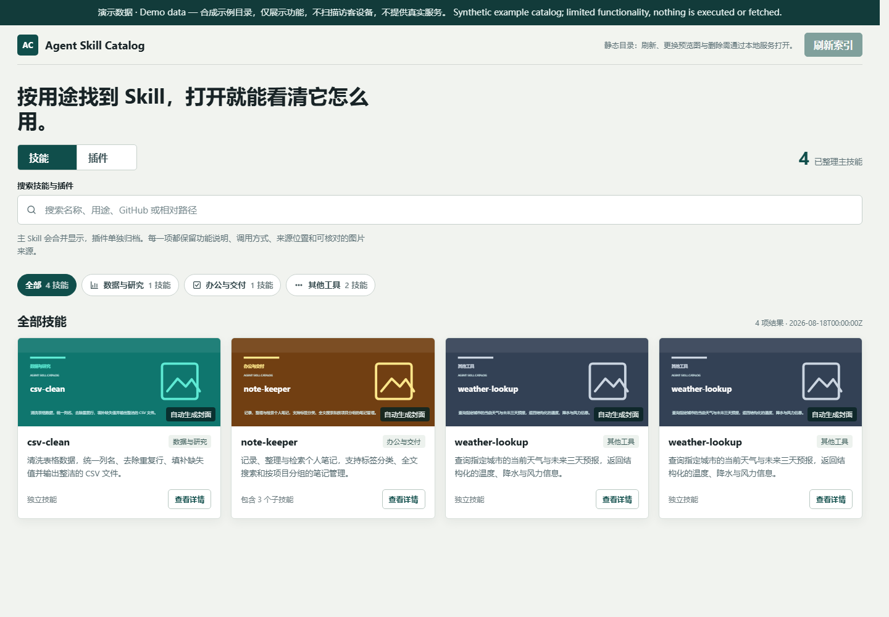
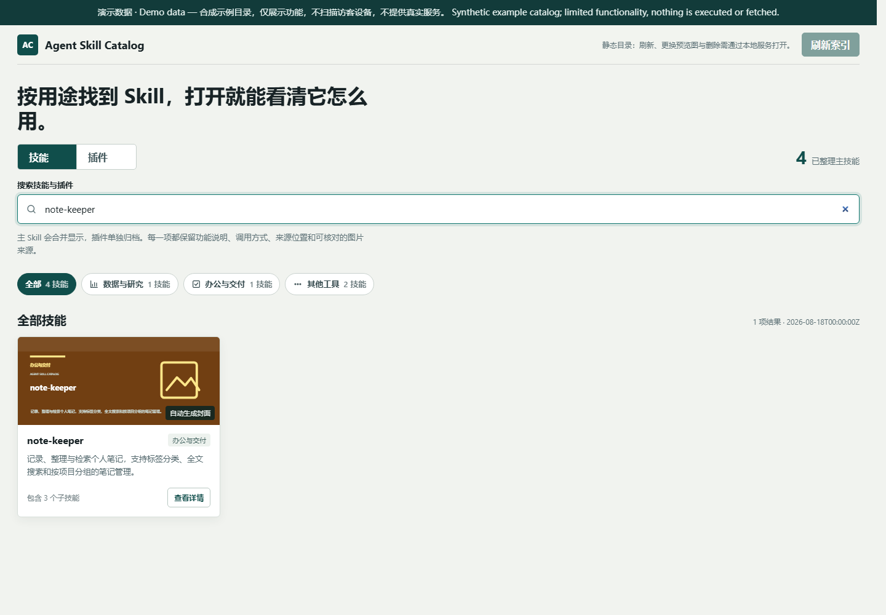
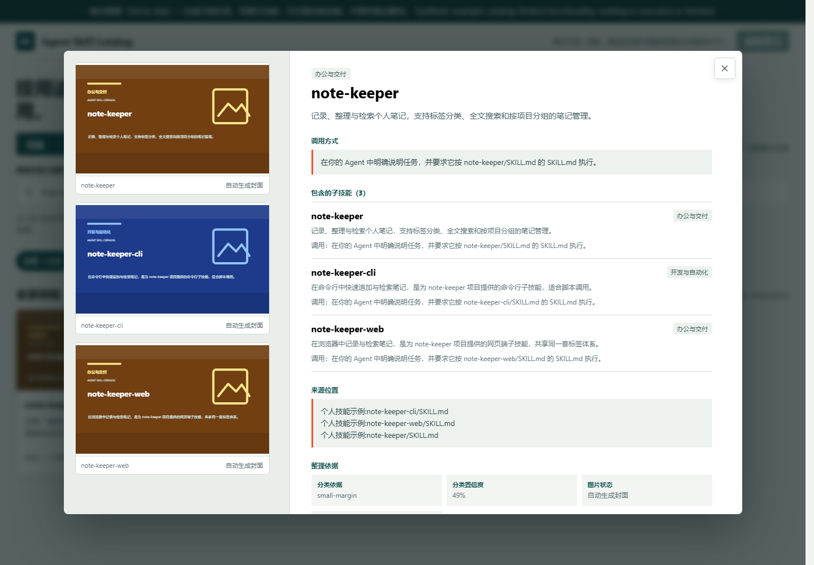

# Agent Skill Catalog 本地 Skill 与插件目录

搜索你已经安装的 Agent Skills。

把它指向存放 `SKILL.md` 的目录，它会生成一份可搜索、自包含的本地 HTML 目录。找到条目后，可以查看它的来源位置和调用方式，也能分清独立 Skill、有证据的主/子家族和插件携带的能力。

当前生成的目录界面是中文。本仓库文档提供英文和中文两个版本，但这不代表生成的界面本身支持双语。GitHub 增强是可选的；如果你的 Skill 库必须完全断网，请使用下面的明确离线参数。

<table align="center"><tr><td><a href="https://github.com/mianbaofang/agent-skill-catalog/actions/workflows/validate.yml"></a></td><td><a href="LICENSE"></a></td><td><a href="https://github.com/mianbaofang/agent-skill-catalog/releases/tag/v0.3.6"></a></td></tr></table>

<p align="center">
  <a href="README.md">English</a>
  &middot;
  <a href="skills/agent-skill-catalog/SKILL.md">Skill</a>
  &middot;
  <a href="docs/DEMO.md">产品演示</a>
  &middot;
  <a href="https://mianbaofang.github.io/agent-skill-catalog/index-zh.html">项目主页</a>
  &middot;
  <a href="DISCLAIMER.md">免责声明</a>
  &middot;
  <a href="ACKNOWLEDGEMENTS.md">致谢</a>
  &middot;
  <a href="CHANGELOG.md">更新记录</a>
  &middot;
  <a href="SECURITY.md">安全说明</a>
</p>

<p align="center">
  <a href="docs/DEMO.md">
    
  </a>
</p>

## 安装

用 GitHub CLI 安装已发布的 Skill（这是在 Windows 上实测通过的路径）：

```powershell
gh skill install mianbaofang/agent-skill-catalog agent-skill-catalog --pin main --agent codex --scope user
```

`--pin main` 安装仓库 `main` 分支上的最新源码。上一个打过标签的版本是 [`v0.3.6`](https://github.com/mianbaofang/agent-skill-catalog/releases/tag/v0.3.6)；想用之前发布的稳定版本时，改成固定该版本即可。

安装后告诉 Agent 要扫描哪些目录：

```text
请使用 agent-skill-catalog 扫描我的本地 Skill 根目录和 Codex 插件缓存。
独立 Skill 与插件分开，真实主/子 Skill 家族聚合显示；
不要安装、修改或执行任何被扫描内容。
```

## 从源码生成第一份目录

`gh skill install` 会把脚本放进已安装的 Skill 包里，而不是本仓库的工作副本。要按下文方式运行构建器，请先克隆或下载本仓库，并从它的根目录运行，让指向 `build_catalog.py` 的相对路径能解析：

```bash
git clone https://github.com/mianbaofang/agent-skill-catalog.git
cd agent-skill-catalog
```

接下来把两个路径换成真实存在的 Skill 文件夹和一个空输出文件夹。这条首次命令完全离线，并且**不会**等待缺失的中文说明：

Bash：

```bash
python skills/agent-skill-catalog/scripts/build_catalog.py \
  --root "/path/to/skills" \
  --output-dir "/path/to/catalog-output" \
  --no-github-discovery \
  --no-github-images
```

PowerShell：

```powershell
python skills/agent-skill-catalog/scripts/build_catalog.py `
  --root "C:\path\to\skills" `
  --output-dir "$env:TEMP\agent-skill-catalog-preview" `
  --no-github-discovery `
  --no-github-images
```

退出码 0 表示已生成 `catalog.json` 和自包含的 `index.html`。用浏览器打开 `index.html` 即可搜索。如果输出文件夹里已经有 `catalog.json`，构建器会停下来，要求你加 `--refresh` 重跑；重跑前请先确认目标文件夹里是愿意重新生成的目录。

### 两种完成状态

| 构建 | 命令 | 成功是什么样 |
|---|---|---|
| 快速预览 | `build_catalog.py ... --no-github-discovery --no-github-images` | 退出码 0。中文说明还没补齐的条目也会出现，可以立刻浏览和搜索。 |
| 完整目录 | 追加 `--require-complete-descriptions` | 退出码 0 **且** `pending_description_count` 为 0。退出码 3 表示中文说明仍在补齐，不是程序崩溃。 |

完整路径由 Agent 驱动：它通过可续跑的 `description_queue.py next/apply` 循环，依据有长度限制的本地 `SKILL.md` 和 GitHub README 证据补齐缺失的中文说明，再用 `--refresh --require-complete-descriptions` 重建，直到队列清空。Python 脚本不会暗中调用模型，也不需要模型密钥。完整的补全流程见[生成完全离线的 Skill 目录](https://mianbaofang.github.io/agent-skill-catalog/guides/offline-skill-catalog-zh.html)，面向 Agent 的步骤见 Skill 包中的 `references/workflow.md`。

## 任务教程

每篇教程只解决一个具体任务，含跨平台命令、预期结果、边界和排错：

- [搜索你已经安装的 Agent Skills](https://mianbaofang.github.io/agent-skill-catalog/guides/search-installed-skills-zh.html) —— 选定一个明确根目录，生成目录，搜索并打开某个 Skill 的调用方式和来源。
- [生成完全离线的 Skill 目录](https://mianbaofang.github.io/agent-skill-catalog/guides/offline-skill-catalog-zh.html) —— 关闭所有 GitHub 请求，并分清快速预览与完整目录两种完成状态。
- [跨目录清点 Skill 与插件](https://mianbaofang.github.io/agent-skill-catalog/guides/skills-and-plugin-inventory-zh.html) —— 扫描多个根目录，按插件分组，读懂有证据的重复副本、同名冲突和家族的区别。

这些教程描述的是当前中文目录界面。

## 一眼看懂

| 问题 | 回答 |
|---|---|
| 扫描什么？ | 只扫描你明确传入的本地根目录，也可以把插件缓存作为独立根目录标记。 |
| 什么会显示为一个条目？ | 一个独立 Skill，或一个详情里列出子 Skill 的真实主 Skill/家族记录。 |
| 重复安装怎么处理？ | GitHub 仓库和 Skill 名称相同的副本只显示一次，但所有来源位置都会保留下来。 |
| 插件怎么显示？ | 插件聚合有独立视图，不计入独立 Skill 的数量。 |
| 保留哪些信息？ | 分类候选、置信度、胜出边际、来源位置、调用方式、图片来源，以及证据支持时的 GitHub 仓库地址。 |
| 没有图片证据怎么办？ | 明确显示 `missing evidence`，不会把生成的分类封面伪装成 Skill 专属图片。 |
| 哪些事不会做？ | 扫描不会写入你的根目录。唯一可选、默认关闭的服务器能力和可选的网络读取见[安全与责任边界](#安全与责任边界)。 |

## 使用方式

| 模式 | 什么时候用 | 输出 |
|---|---|---|
| 静态生成 | 只需要一个可分享的本地页面 | 确定性的 `catalog.json` 和自包含 `index.html`。 |
| 本地服务 | 需要刷新和手工改图 | 静态目录加仅监听 localhost 的 `/api/refresh` 与 `/api/image` 接口。 |
| 人工整理 | 自动证据存在歧义 | 单独 JSON 文件中的分类、家族、说明、GitHub 或图片覆盖。 |
| 插件清单 | 扫描插件缓存 | 独立插件视图，以及每个插件携带的 Skill 清单。 |

需要页面内的“刷新索引”按钮时，用同一批根目录启动本地服务。加上两个离线参数，让刷新路径也保持离线：

```powershell
python skills/agent-skill-catalog/scripts/serve_catalog.py `
  --output-dir "$env:TEMP\agent-skill-catalog-preview" `
  --root "C:\path\to\skills" `
  --no-github-discovery `
  --no-github-images
```

## 产品截图

下面截图来自一份真实生成的目录，生成的界面是中文。上方录制的演示动画是由本项目自建的合成测试夹具制作的产品说明，不是安装或运行依赖。

<table align="center"><tr><td></td></tr></table>

<table align="center"><tr><td></td></tr></table>

<table align="center"><tr><td></td></tr></table>

## 网络行为与关闭方式

默认构建**不保证**离线。下面列出会联网的具体行为，以及对应的关闭参数：

| 行为 | 触发时机 | 关闭参数 |
|---|---|---|
| 把库里的 Skill 名称作为 `"<name>" in:name` 查询发送到 GitHub 仓库搜索接口，为还没有仓库元数据的条目寻找候选仓库。 | 默认构建 | `--no-github-discovery` |
| 对已确认的仓库，从允许的 GitHub 域名抓取一张公开预览图，缓存在输出目录。 | 默认构建 | `--no-github-images` |
| 抓取公开 GitHub README 片段，作为中文说明队列的证据。 | `description_queue.py next` | `--no-github-readmes` |

GitHub 读取仅使用 HTTPS、限制域名并限制大小。如果设置了 `GH_TOKEN` 或 `GITHUB_TOKEN` 环境变量，或者你已经用 GitHub CLI 登录，这些读取会复用现有凭据；目录不会保存它。使用 `--no-github-discovery --no-github-images`（运行说明队列时再加 `description_queue.py next --no-github-readmes`）即可完全不发出 GitHub 请求。

## 安全与责任边界

- 扫描根目录由操作者明确给出，并保持只读；构建器不会遍历无关目录。
- 本地服务有一项可选删除能力，除非你对某个根目录把 `allow_delete` 显式设为 `true`，否则保持关闭。启用后，它可能在确认完整 Skill 名称后永久删除扫描来源中一个顶层独立 Skill 目录。家族和插件条目被排除，它删除的也不是根目录配置。想要严格只读的浏览环境时，请保持关闭。
- Skill 自己声明的远程图片地址仍然只保留为元数据。确认到 GitHub 仓库后，构建器只访问公开仓库页面和允许的 GitHub 图片域名，下载内容有大小限制并检查图片签名。
- 手工预览图只写入输出目录的 `curated-images/` 与 `catalog-curation.json`。
- 默认隐藏绝对路径；只有明确的本地诊断任务才使用 `--include-absolute-paths`。
- 刷新只接受启动时记录的根目录、标签、类型、配置和整理文件。
- 分类、家族、图片和 GitHub 说明都来自扫描结果或整理文件；无法确认的记录会保留复核标记。

完整边界见[免责声明](DISCLAIMER.md)和[安全说明](SECURITY.md)。

## 仓库结构

```text
skills/agent-skill-catalog/SKILL.md GitHub 可发现的 Skill 入口
skills/agent-skill-catalog/       版本化可安装 Skill 包
skills/agent-skill-catalog/references 配置、Schema、整理和工作流
skills/agent-skill-catalog/scripts   扫描器、HTML 渲染器和受限服务
docs/                              项目主页、任务教程和生成的演示
docs/media/                        README 截图和产品动画
tests/                             确定性行为检查
tools/                             包和发布校验
.github/                           CI、Issue 和 PR 模板
CHANGELOG.md                       版本记录
```

## 状态

- 当前已发布版本是 [`v0.3.6`](https://github.com/mianbaofang/agent-skill-catalog/releases/tag/v0.3.6)。
- 可安装包是 [`agent-skill-catalog-skill.zip`](https://github.com/mianbaofang/agent-skill-catalog/releases/latest/download/agent-skill-catalog-skill.zip)。
- 包校验文件是 [`agent-skill-catalog-skill.zip.sha256`](https://github.com/mianbaofang/agent-skill-catalog/releases/latest/download/agent-skill-catalog-skill.zip.sha256)。
- 校验范围包括 GitHub Skill 发现、安装包结构、Python 编译、目录测试和发布打包，CI 与发布前都会运行这些检查。

版本历史见[更新记录](CHANGELOG.md)。

## 致谢

项目遵循公开的 [Agent Skills 规范](https://agentskills.io/specification)，扫描、确定性 JSON 生成和本地 HTTP 服务只使用 Python 标准库。README 动画由原创信息图与真实目录 UI 录屏组成。公开演示和截图使用为本项目自建、放在 `examples/` 下的合成夹具，它们不属于可安装的 Skill 包。你自己安装的 Skill、私人提示词和私人资产都不会被打包。

完整归属与非从属说明见[致谢](ACKNOWLEDGEMENTS.md)。

## 作者

Ethan <ethan.zl@hotmail.com>

## 许可证

MIT.
